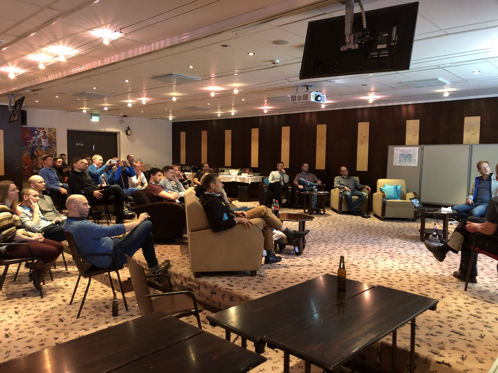
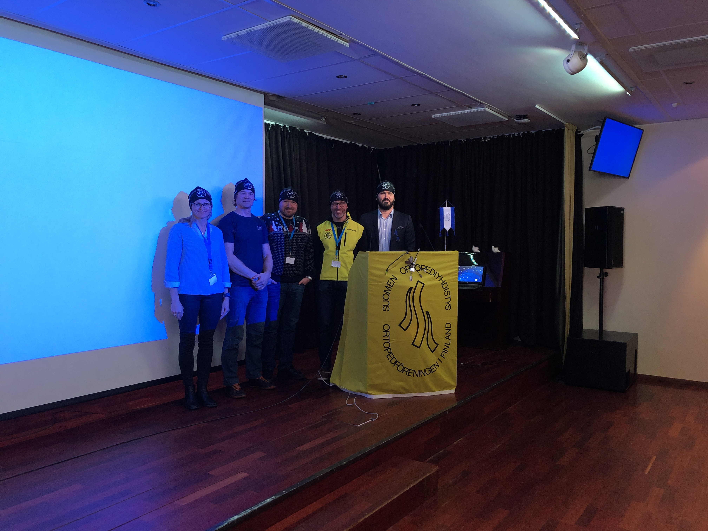
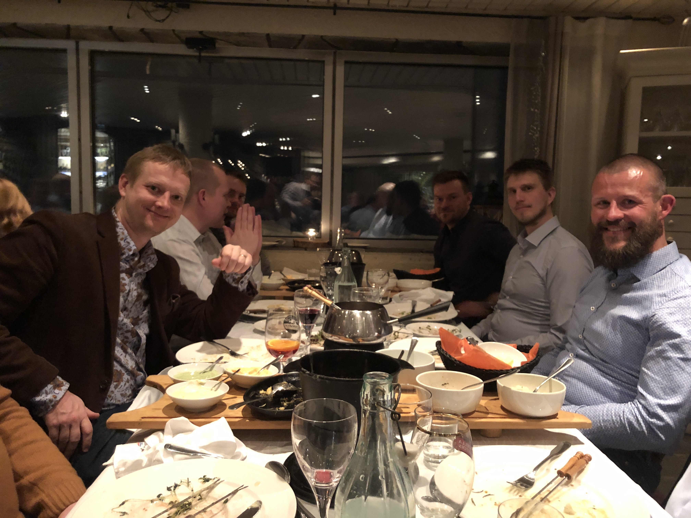

# Historia

Suomen Ortopediyhdistys (SOY) perustettiin 17. maaliskuuta 1951. Vuosikymmenten aikana yhdistyksestä on kasvanut Suomen suurin kirurgian alan erikoisalayhdistys.

SOY:n järjestelmällinen kurssitoiminta alkoi vuonna 1970 kaksipäiväisellä jatkokoulutustilaisuudella, joka käsitteli lannerangan kipuoireyhtymiä ja pidettiin Helsingin kauppakorkeakoulussa. Ensimmäinen kurssi oli erittäin onnistunut, ja sen ansiosta yhdistykseen perustettiin vuonna 1972 ensimmäinen kurssitoimikunta. Toimikunnan tavoitteena oli luoda uudenlainen kurssimuoto, jonka esikuvina toimivat Sveitsin AO-kurssit ja vastaavat ohjelmat Ruotsissa. Kurssimuodon kehittämiseksi toimikunta osallistui keväällä 1973 kirurgien koulutustilaisuuteen (Vidareutbildningskurs för blivande kirurger) Ruotsin Östersundissa ja Åressa.

Ensimmäinen Lapinkurssi (Arctic Orthopedic Summit) järjestettiin vuonna 1974 Rovaniemellä (Lapland). Aluksi kurssi oli käytännönläheinen: osallistujat harjoittelivat murtuman kiinnitystä luunäytteillä klassisen AO-kurssimallin mukaisesti. Alkuvuosina ohjelmaan sisältyi jopa artroskooppisen kirurgian harjoittelua kadaveripreparaateilla.

Viimeisten 30 vuoden aikana kurssi on muuttunut luentopainotteisemmaksi ja nojaa yhä enemmän näyttöön perustuvaan lääketieteeseen. Pienryhmäkeskustelujen eli niin sanottujen ”takkakeskustelujen” perinne on kuitenkin säilynyt. Vaikka osallistujamäärän kasvu on kasvattanut ryhmät alkuperäisiä tiiviitä kokoonpanoja suuremmiksi, rento tunnelma on säilynyt ja edistää avointa ja rakentavaa keskustelua.

Kursseilta on syntynyt monia rakkaita perinteitä, ja niillä solmitaan uusia ystävyyssuhteita ja vaalitaan pitkäaikaisia. Kohokohtiin kuuluvat koko perheelle sopivat hiihtokilpailut sekä juhlava gaalaillallinen, jonka tunnelma on tyylikäs mutta lämmin.

Vaikka kotimaisten ja kansainvälisten kongressien tarjonta on kasvanut, kurssi on viime vuosina houkutellut tasaisesti 150-180 osallistujaa. Tapahtuma on peruttu vain kerran, vuonna 2022 pandemian vuoksi. Kurssi järjestettiin sen sijaan vuonna 2023, mikä poikkesi tilapäisesti perinteisestä kahden vuoden välein toistuvasta aikataulusta.

Tervetuloa tekemään kanssamme 51. juhlavuoden Arctic Orthopedic Summitista unohtumaton kokemus!
